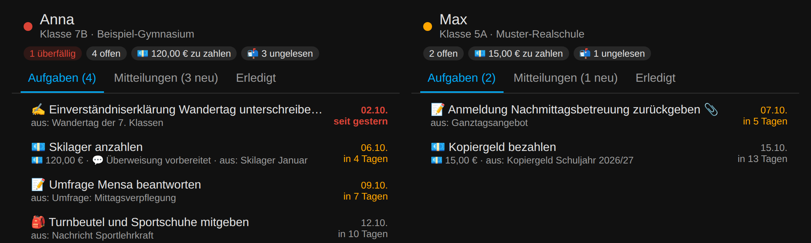
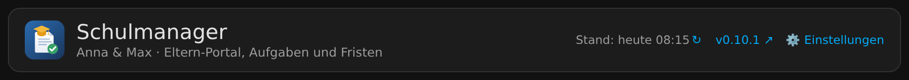
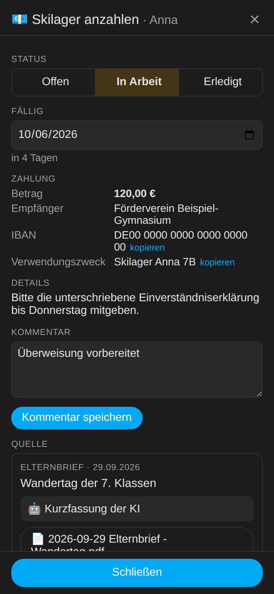
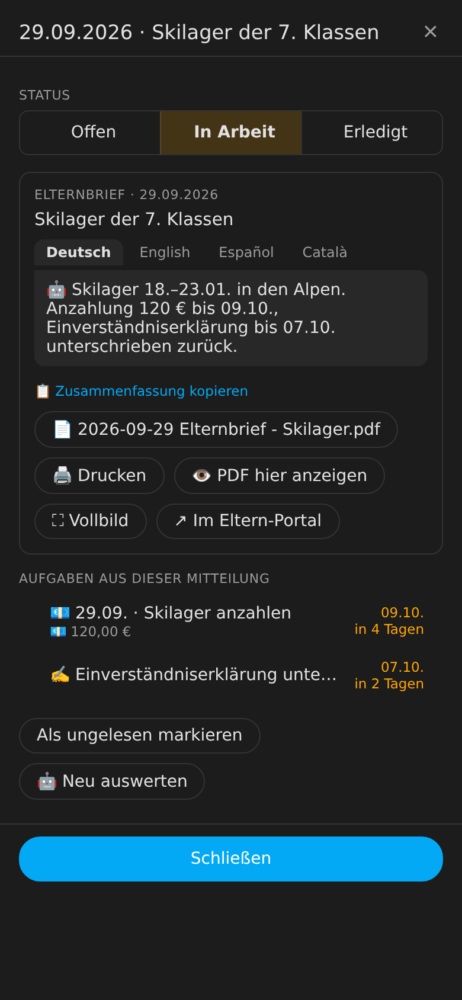
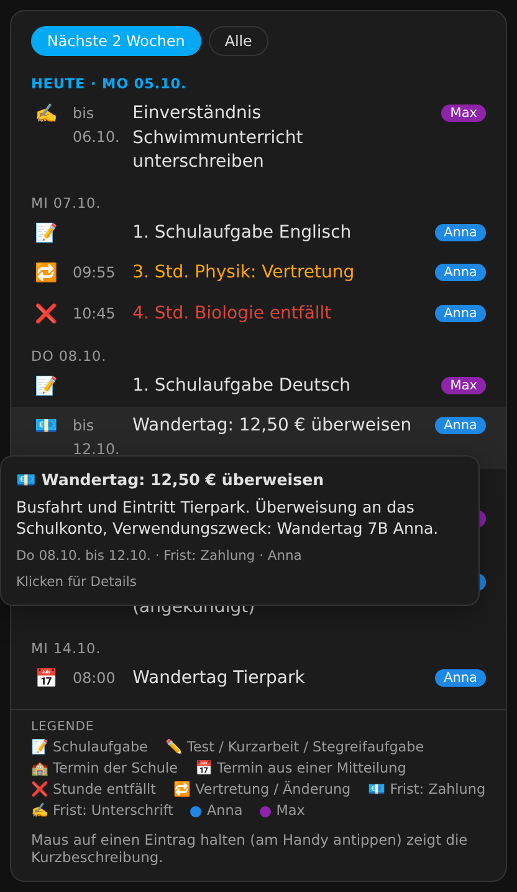
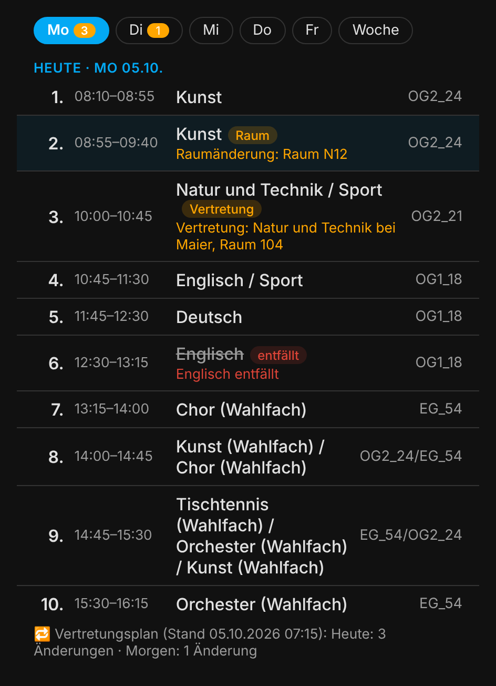
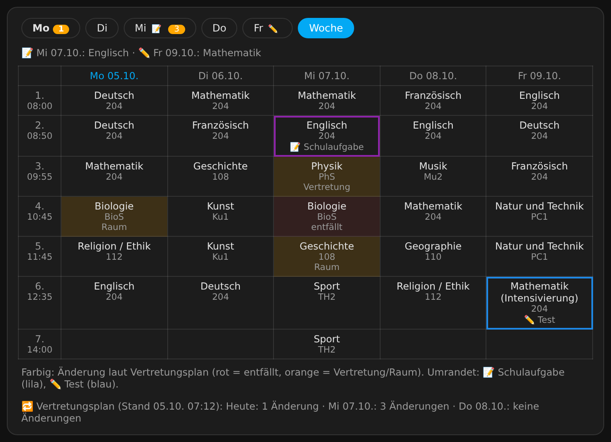

# Eltern Portal Manager Bavaria für Home Assistant

**English:** [README.md](README.md)

**Eltern Portal Manager Bavaria** (früher *Schulmanager*) holt alle Mitteilungen aus dem **[Eltern-Portal](https://www.eltern-portal.org)** selbst ab, legt Elternbriefe und Anhänge pro Kind ab, lässt eine KI daraus Aufgaben, Fristen, Zahlungen und Termine herauslesen und erinnert euch rechtzeitig: per Push aufs Handy, morgens als Tagesübersicht, per Sprachansage und als Ampel im Dashboard. Mehrere Kinder und Schulen laufen in einer Installation.



> [!NOTE]
> Eltern Portal Manager Bavaria ist ein privates Hobbyprojekt und steht in keiner Verbindung zum Anbieter des Eltern-Portals. Die Integration liest die Webseiten des Portals aus, weil es keine offizielle Schnittstelle gibt; Änderungen am Portal können einzelne Funktionen jederzeit stören. Nutzung auf eigene Verantwortung, ohne Gewähr. Fehler und Wünsche gerne als [Issue](https://github.com/FabusMingAI/ha-schulmanager/issues) – Antworten kommen, wenn Zeit ist.

> [!IMPORTANT]
> **Früher „Schulmanager“.** Bis Version 0.13 hieß diese Integration *Schulmanager* und nutzte die Domain `schulmanager`. Dieselbe Domain nutzt **[Schulmanager Online](https://github.com/MrIcemanLE/Schulmanager-homeassistant)** – eine andere Integration für Schulen mit *schulmanager-online.de* –, deshalb ließen sich beide nicht gleichzeitig installieren. Seit 0.14 heißt diese Integration **Eltern Portal Manager Bavaria** (Domain `eltern_portal_schulmanager`), und beide laufen nebeneinander, z. B. ein Kind an einer Schule mit Eltern-Portal und eines an einer Schule mit Schulmanager Online. Update von 0.13 oder älter? Siehe [Umbenannt: früher Schulmanager](#umbenannt-früher-schulmanager) – ab 0.14.1 wird die bestehende Einrichtung automatisch übernommen.

## Was passiert automatisch

| Schritt | Was die Integration tut |
|---|---|
| Abruf (alle 30 min) | Elternbriefe, Nachrichten der Fachlehrkräfte, Schwarzes Brett, Umfragen, **Schulaufgaben und Tests**, **Stundenplan**, **Vertretungsplan** und **Krankmeldungen** aus allen Portalen lesen |
| Ablage | PDFs und Anhänge unter `Medien › eltern_portal_schulmanager › <Kind> › <Schuljahr>` speichern, z. B. `Anna/2026-27/2026-09-30 Elternbrief - Wandertag.pdf` |
| Auswertung | Text und PDF-Inhalt an den KI-Dienst von Home Assistant ([AI Task](https://www.home-assistant.io/integrations/ai_task/)) geben: Zusammenfassung, Dringlichkeit, Aufgaben (zahlen, unterschreiben, zurückgeben, mitbringen …), Fälligkeiten, Beträge, IBAN und Verwendungszweck, Termine. Ohne KI gibt es eine einfache Erkennung von Datum und Betrag. |
| Portal-Aufgaben | Offene Umfragen werden zu „Umfrage beantworten“, Briefe ohne Datei zu „Empfang im Portal bestätigen“. Beide haken sich von selbst ab, sobald das im Portal erledigt ist. |
| Push | Pro neuer Mitteilung eine Nachricht an die gewählten Handys, mit den Buttons **Gelesen**, **Erledigt** und **Im Portal öffnen** |
| Vertretungen | Neue Vertretungen, Ausfälle und Raumänderungen ab heute kommen als Push, z. B. „🔁 Vertretungsplan Anna – Morgen: 6. Std. E entfällt“. Beim allerersten Abruf gibt es keine Push. |
| Erinnerung (18:30) | Standardmäßig 3 Tage vorher, am Vortag und am Tag selbst, Überfälliges täglich. Buttons **Erledigt** und **Morgen erinnern**. |
| Tagesübersicht (06:45) | Nur wenn etwas ansteht: Ampel pro Kind, Fristen, Ungelesenes, heutige Termine, heutige Vertretungen und Schulaufgaben/Tests von morgen |
| Sprachansage | Bei dringenden neuen Mitteilungen und bei Fristen heute/morgen, nur im eingestellten Zeitfenster |

## Die Karten

Die Integration lädt vier Karten automatisch und baut sie ins Dashboard „Schule“ ein. HACS-Frontend-Ressourcen braucht es nicht. Alle Karten nehmen optional `child: <kind>`, ohne Angabe zeigen sie alle Kinder.

### Kopfzeile – `custom:eltern-portal-schulmanager-header`

<p align="left"></p>

- Steht oben auf der Übersicht des Dashboards. Rechtsbündig: **wann zuletzt aus dem Eltern-Portal abgerufen wurde** (↻ ruft sofort ab, ⚠️ zeigt Fehler beim Abruf), die **installierte Version** mit Link zum Release auf GitHub und „⚙️ Einstellungen“.
- Optionen: `subtitle`, `icon`, `settings_path`.

### Aufgaben & Mitteilungen – `custom:eltern-portal-schulmanager-card`

Zeigt pro Kind die Reiter **Aufgaben**, **Mitteilungen** und **Erledigt**.

<p align="left"> </p>

- Jede Aufgabe trägt vor dem Titel das **Erscheinungsdatum der Mitteilung im Eltern-Portal** (`29.09. · Skilager anzahlen`; eigene Aufgaben: der Tag, an dem sie angelegt wurden) – ebenso in den Dialogen (mit Jahr), in der Tagesübersicht und in den To-do-Listen.
- Während KI-Zusammenfassungen übersetzt werden (z. B. nach dem Hinzufügen einer Sprache), zeigt die Karte oben „🌐 Zusammenfassungen werden übersetzt …: 34 von 90“.
- **Status-Icon einer Aufgabe antippen** ändert den Status direkt in der Liste: Kreis (offen) oder ⏳ (in Arbeit) setzt sie auf **erledigt**, der grüne Haken öffnet sie wieder. Erledigte Aufgaben sind nicht mehr durchgestrichen – Haken und Reiter **Erledigt** sagen das schon.
- **Text einer Aufgabe antippen** öffnet die Details: Status **Offen / In Arbeit / Erledigt**, Fälligkeit ändern, eigener **Kommentar**, Zahlungsdaten mit „kopieren“ für IBAN und Verwendungszweck, dazu die **Quelle** mit KI-Zusammenfassung, Originaltext, PDF und Link ins Eltern-Portal.
- **Mitteilung antippen** zeigt Text, PDF und die daraus entstandenen Aufgaben und markiert die Mitteilung als gelesen. Auch Mitteilungen haben den Status **Offen / In Arbeit / Erledigt**: Erledigte wandern in den Reiter **Erledigt** (und gelten als gelesen), Mitteilungen in Arbeit tragen ⏳.
- Unter dem Reiter **Mitteilungen**: **Alle als gelesen markieren** und **Alle als erledigt markieren** (mit Rückfrage; sie wandern nach **Erledigt**).
- Fristen haben im Aufgaben-Dialog **📅 In Kalender eintragen** und **Google Kalender** (siehe unten).
- Die **KI-Zusammenfassung** hat einen Reiter je Sprache, die in den Einstellungen gewählt ist (Deutsch, Englisch, Spanisch, Katalanisch).
- **Text kopieren:** Alles in den Dialogen lässt sich markieren; „📋 … kopieren“ kopiert die KI-Zusammenfassung oder den Text der Mitteilung bzw. PDF, „kopieren“ neben IBAN und Verwendungszweck nur diesen Wert.
- **PDFs:** „Drucken“ öffnet den Druckdialog des Browsers, „Vollbild“ zeigt das PDF bildschirmfüllend (am Handy ohne Vollbild-Unterstützung öffnet es sich in einem neuen Tab).
- „In Arbeit“ zählt weiter als offen: Die Aufgabe bleibt in Ampel und Erinnerungen und steht in der To-do-Liste mit ⏳.

### Termine & Fristen – `custom:eltern-portal-schulmanager-termine`

<p align="left"></p>

- Alle Termine, Fristen und Änderungen aus dem Vertretungsplan nach Tagen sortiert, Überfälliges oben. Umschalten zwischen **Nächste 2 Wochen**, **Alle** und **📦 Archiv**.
- **Erledigtes archivieren:** Maus auf einen Eintrag (am Handy ist der Knopf immer sichtbar) und auf **📦** klicken. Der Eintrag verschwindet aus der Liste und landet im **📦 Archiv** (rechts neben **Alle**, mit Anzahl). Dort holt **↩️** ihn zurück. Funktioniert auf der Übersicht und in jedem Kinder-Reiter; das Archiv liegt in Home Assistant und ist auf allen Geräten gleich. Archivieren blendet nur in der Karte aus – Fristen bleiben offene Aufgaben mit Erinnerung, der Kalender bleibt unverändert. Einträge, die es nicht mehr gibt, verschwinden automatisch aus dem Archiv.
- **Eintrag antippen bzw. anklicken** klappt ihn auf, erneutes Antippen klappt ihn zu – bei allen Arten gleich. Aufgeklappt stehen dort Kurzbeschreibung der KI, Ort und Quelle, bei Fristen und Terminen aus einem Brief **Aufgabe öffnen › / Mitteilung öffnen ›** und **📅 In Kalender eintragen**. Mit der Maus zeigt schon das Darüberfahren die Kurzbeschreibung.
- **📅 In Kalender eintragen** übernimmt genau diesen einen Eintrag in den eigenen Kalender – ihr entscheidet selbst, welche. Es öffnet eine `.ics`-Datei: iPhone/iPad (Safari) bietet „Zum Kalender hinzufügen“ an, Outlook und die meisten Kalender-Apps öffnen sie als Termin zum Speichern. **Google Kalender** legt den Termin im Google Kalender an (praktisch auf Android, wo `.ics` nicht immer direkt importiert wird). Nochmaliges Eintragen aktualisiert den Termin statt ihn doppelt anzulegen (gleiche `UID`). Fristen erinnern am Vortag um 18 Uhr, Termine mit Uhrzeit eine Stunde vorher. Die Links sind signiert und 24 Stunden gültig. In der Home-Assistant-App öffnet sich der Link im Browser.
- Unten erklärt eine **Legende** die Icons: 📝 Schulaufgabe, ✏️ Test / Kurzarbeit / Stegreifaufgabe, 🏫 Termin der Schule, 📅 Termin aus einer Mitteilung, ❌ Stunde entfällt, 🔁 Vertretung, 🚪 Raumänderung, 🤒 Krankmeldung und die Fristen nach Art (💶 Zahlung, ✍️ Unterschrift, ↩️ Rückmeldung, 🎒 Mitbringen, 📖 Lesen, ✅ Aufgabe). Bei mehreren Kindern hat jedes eine eigene Farbe.

### Stundenplan & Vertretungen – `custom:eltern-portal-schulmanager-stundenplan`

<p align="left"></p>

<p align="left"></p>

<p align="left"><sub>Die Screenshots zeigen erfundene Demo-Daten (`docs/screenshots/demo.html`, neu erzeugen mit `python docs/screenshots/make_screenshots.py`).</sub></p>

- Tagesansicht mit Uhrzeit und Raum, umschaltbar auf die **Woche**. Vormittags zeigt sie den heutigen Tag, nach Schulschluss und am Wochenende den nächsten Schultag. Mit `view: week` startet die Karte in der Wochenansicht; das Dashboard „Schule“ nutzt das für alle Stundenpläne.
- Die Wochenansicht passt auch in schmale Karten (halbe Spalte, Handy), ohne dass man seitlich scrollen muss: Fächer werden dort abgekürzt („Mathe“, „Engl.“, „Reli/Eth“, „SA“ für Schulaufgabe).
- Fächer stehen **ausgeschrieben** da („Biologie“ statt „B“, „Mathematik (Intensivierung)“ statt „MInt“, „Sport“ statt „Sm/Sw“). Das Original-Kürzel erscheint, wenn man mit der Maus darauf zeigt.
- Änderungen aus dem Vertretungsplan sind farbig markiert: rot = entfällt, orange = Vertretung oder Raumänderung. Die Zahl an den Wochentagen zeigt, wie viele Änderungen anstehen.
- In der Tagesansicht zeigt Antippen eines Schulaufgaben-/Test-Kastens oder einer Vertretung **📅 In Kalender eintragen** / **Google Kalender**.
- **Schulaufgaben und Tests** aus den Portal-Terminen sind hervorgehoben: 📝 / ✏️ an den Wochentagen, ein Kasten über den Stunden des Tages und eine Markierung am passenden Fach (lila = Schulaufgabe, blau = Test). Was in den nächsten zwei Wochen ansteht, steht über dem Stundenplan.

## Voraussetzungen

- Home Assistant **2025.8** oder neuer (eigenes Integrations-Icon ab 2026.3)
- Ein Eltern-Zugang zum Eltern-Portal (`https://<schule>.eltern-portal.org`)
- Optional: eine AI-Task-Entität (z. B. aus der Anthropic-, OpenAI-, Google- oder Ollama-Integration)

## Installation

### Über HACS (empfohlen)

1. **HACS** öffnen und nach **Eltern Portal Manager Bavaria** suchen.
2. Die Integration installieren und Home Assistant neu starten.

Bis zur Aufnahme in den HACS-Standardkatalog einmalig über HACS → ⋮ → **Benutzerdefinierte Repositories** → `https://github.com/FabusMingAI/ha-schulmanager` mit Typ **Integration** hinzufügen und dann die Schritte oben ausführen.

[](https://my.home-assistant.io/redirect/hacs_repository/?owner=FabusMingAI&repository=ha-schulmanager&category=integration)

### Von Hand

Den Ordner `custom_components/eltern_portal_schulmanager` nach `/config/custom_components/eltern_portal_schulmanager` kopieren (Samba, Add-on „File editor“ oder Studio Code Server) und Home Assistant neu starten.

## Umbenannt: früher Schulmanager

Bestehende Installationen werden vollständig übernommen: Zugangsdaten, Einstellungen, Aufgaben, Mitteilungen mit Status und Kommentaren, das Archiv, KI-Zusammenfassungen, abgelegte Dateien, Entity-IDs und deren Verlauf.

**Ab 0.14.1 passiert das automatisch.** Version 0.14.1 ist ein Brücken-Release: Sie kommt noch einmal unter dem alten Namen *Schulmanager*, installiert *Eltern Portal Manager Bavaria* und übernimmt die Einrichtung von selbst. Eine Benachrichtigung bestätigt das – danach **Home Assistant noch einmal neu starten**. Fertig.

**Noch auf 0.13 oder älter?** Neuere Versionen (ab 0.14.2) enthalten die Brücke nicht mehr, deshalb zuerst 0.14.1 installieren: HACS → *Eltern Portal Manager Bavaria* → ⋮ → **Erneut herunterladen** → Version **v0.14.1** wählen → *Herunterladen*, dann Home Assistant neu starten (wie oben zweimal). Danach das neueste Update wie gewohnt installieren. (Zeigt die Kopfzeile des Dashboards „Schule“ nach dem Update auf 0.14.2 oder neuer noch Version 0.13, liegt es daran.)

> **Zusätzlich [Schulmanager Online](https://github.com/MrIcemanLE/Schulmanager-homeassistant) im Einsatz?** Er nutzt denselben Ordner `custom_components/schulmanager`. Wer schon mit 0.14.0 von Hand übernommen *und* danach Schulmanager Online installiert hat, überspringt 0.14.1 und aktualisiert direkt auf 0.14.2 oder neuer – diese Versionen installieren wieder nach `custom_components/eltern_portal_schulmanager` und lassen den Ordner von Schulmanager Online in Ruhe.

Klappt die automatische Übernahme nicht, steht unter *Einstellungen → Reparaturen* **„Schulmanager konnte nicht zu Eltern Portal Manager Bavaria umziehen“**. Einmal neu starten; bleibt der Hinweis, von Hand übernehmen:

1. **Einstellungen → Geräte & Dienste → Integration hinzufügen → Eltern Portal Manager Bavaria** (oder [diesen Link](https://my.home-assistant.io/redirect/config_flow_start/?domain=eltern_portal_schulmanager) öffnen). Die Einrichtung findet die alte und bietet **Übernehmen** an – Passwörter müssen nicht neu eingegeben werden.
2. **Home Assistant noch einmal neu starten.** Eine Benachrichtigung bestätigt die Übernahme.

[](https://my.home-assistant.io/redirect/config_flow_start/?domain=eltern_portal_schulmanager)

Was sich ändert:

| Bis 0.13 | Ab 0.14 |
|---|---|
| Integration *Schulmanager*, Domain `schulmanager` | *Eltern Portal Manager Bavaria*, Domain `eltern_portal_schulmanager` |
| Aktionen `schulmanager.refresh`, `schulmanager.mark_read`, … | `eltern_portal_schulmanager.refresh`, `eltern_portal_schulmanager.mark_read`, … |
| Events `schulmanager_new_item`, `schulmanager_task_reminder`, `schulmanager_substitution` | `eltern_portal_schulmanager_new_item`, `eltern_portal_schulmanager_task_reminder`, `eltern_portal_schulmanager_substitution` |
| Karten `custom:schulmanager-card`, `-termine`, `-stundenplan`, `-header` | `custom:eltern-portal-schulmanager-card`, `-termine`, `-stundenplan`, `-header` |
| Dateien unter `Medien › schulmanager › …` | `Medien › eltern_portal_schulmanager › …` |

Das passiert bei der Übernahme automatisch:

- **Dashboards** – das Dashboard „Schule“ und eigene Dashboards werden auf die neuen Kartentypen umgestellt, Knöpfe mit `schulmanager.*`-Aktionen ebenfalls.
- **Entity-IDs bleiben gleich** (`sensor.schule_<kind>_…`, `todo.schule_<kind>_aufgaben`, `calendar.schule_<kind>_kalender`, `sensor.schulmanager_letzter_abruf`) – Verlauf, Räume und bestehende Karten funktionieren weiter.
- **Abgelegte Dateien** wandern in den neuen Medienordner.
- **Buttons in Push-Nachrichten** von vor dem Update (*Gelesen*, *Erledigt*, *Morgen erinnern*) funktionieren weiter.
- Die alte Dashboard-Ressource, `/config/www/schulmanager` und der alte Ordner `custom_components/schulmanager` werden entfernt – der Ordner nur, wenn er zu diesem Projekt gehört, nie der von Schulmanager Online.

### Reparatur-Hinweis für Automationen und Skripte

Automationen und Skripte werden nie automatisch geändert. Rufen welche noch eine Aktion `schulmanager.…` auf oder reagieren auf ein Event `schulmanager_…`, zeigt Home Assistant unter **Einstellungen → Reparaturen** den Hinweis **„Automationen nutzen noch die alten Schulmanager-Namen“** mit dem Namen jeder betroffenen Automation bzw. jedes Skripts. Einfach auf die neuen Namen aus der Tabelle oben umstellen – der Hinweis verschwindet von selbst, sobald kein alter Name mehr vorkommt (geprüft bei jedem Start und nach jedem Neuladen von Automationen oder Skripten). Ist zusätzlich Schulmanager Online installiert, könnte `schulmanager.refresh` zu ihm gehören und wird deshalb nicht gemeldet.

Nicht übernommen: PDF- und Kalender-Links in Push-Nachrichten von vor dem Update öffnen sich nicht mehr – die Mitteilung dann im Dashboard öffnen.

## Einrichtung

1. **Einstellungen → Geräte & Dienste → Integration hinzufügen → „Eltern Portal Manager Bavaria“**
2. Schulkennung eingeben (der Teil vor `.eltern-portal.org`) oder einfach den Link aus einer Benachrichtigungs-Mail des Portals einfügen, dazu E-Mail und Passwort. Weitere Schulen direkt im selben Dialog hinzufügen.
3. **Integration → Konfigurieren → Einstellungen** – in einklappbaren Abschnitten: *KI & Sprachen*, *Benachrichtigungen & Erinnerungen* und *Termine & Klassen* stehen offen, *Sprachansagen*, *Abruf & Ablage* und *Dashboard* sind zugeklappt. Jedes Feld hat einen kurzen Erklärtext.
   - **KI-Dienst**: eure AI-Task-Entität. Ohne KI greift nur die einfache Regel-Erkennung.
   - **Push an**: z. B. `mobile_app_<handy_1>` und `mobile_app_<handy_2>`
   - **Sprachansagen auf**: Assist-Satelliten (Ansage direkt) oder Lautsprecher (dafür zusätzlich einen TTS-Dienst wählen)
   - **Termine aus dem Portal anzeigen**: Standard sind nur Schulaufgaben und Tests (Test / Kurzarbeit / kl. Leistungsnachweis / Stegreifaufgabe). „Termine der Schule“ (Ferien, Sekretariat, Veranstaltungen …) lassen sich dazuschalten. Gibt das Portal eine Uhrzeit an (z. B. „14:00 - 16:00“), steht der Termin mit dieser Uhrzeit im Kalender, sonst ganztägig.
   - **Nur Termine der eigenen Klasse** (Standard: an): blendet Einträge aus, die ausdrücklich nur andere Klassen oder Jahrgangsstufen nennen, z. B. „Schullandheim 5b+5c“ oder „Grundwissenstest Jgst. 10“. Termine ohne Klassenangabe bleiben sichtbar.
   - **Lehrkräfte im Stunden- und Vertretungsplan**: Standard *Kürzel und Name*, z. B. „Mü (Maria Müller)“; alternativ *Nur Name* oder *Nur Kürzel*.
   - **Sprachen der KI-Zusammenfassung**: Häkchen bei Deutsch, Englisch, Spanisch und/oder Katalanisch (bis zu 4, Standard Deutsch und Englisch). Jede Sprache wird ein eigener Reiter in der Zusammenfassung; die erste gilt für Push-Nachrichten. Fehlt bei schon ausgewerteten Mitteilungen eine Sprache (auch nach dem Hinzufügen einer Sprache), übersetzt die KI im Hintergrund nur die Zusammenfassung – Aufgaben, Termine und Status bleiben unverändert. Ab 5 Übersetzungen kommt eine Benachrichtigung in Home Assistant beim Start (mit geschätzter Dauer) und am Ende; eine fehlgeschlagene Übersetzung wird nach 6 Stunden erneut versucht, höchstens dreimal.
4. **Dashboard**: Die Integration legt das Dashboard **„Schule“** in der Seitenleiste selbst an – mit den Reitern **Übersicht** (links Termine & Fristen aller Kinder, rechts der Stundenplan mit Vertretungen je Kind, oben eine Kopfzeile mit letztem Abruf, Version und Link „⚙️ Einstellungen“) und **einem Reiter pro Kind** (Aufgaben, Mitteilungen, Stundenplan mit Vertretungen, Termine), ideal fürs Handy. Unter **Konfigurieren → Einstellungen → Dashboard „Schule“** lässt sich auf *Eine Seite* oder *Nicht verwalten* umstellen. Von Hand geänderte Dashboards bleiben unangetastet (neu erzeugen mit der Aktion `eltern_portal_schulmanager.rebuild_dashboard`). Die YAML-Datei unter [`dashboard/`](dashboard/schulmanager_dashboard.yaml) ist nur noch ein Beispiel für eigene Dashboards.

Beim ersten Abruf werden die Mitteilungen der letzten 120 Tage übernommen. Nur die der letzten 21 Tage (und alle noch unbestätigten Briefe) werden ausgewertet und als ungelesen markiert, der Rest landet als gelesen im Archiv. Es gibt einmalig eine kurze Einrichtungs-Push statt einer Flut.

## Was in Home Assistant entsteht (pro Kind)

- `sensor.schule_<kind>_status`: Ampel `rot` / `gelb` / `gruen`. In den Attributen stehen alle offenen Aufgaben und die letzten 25 Mitteilungen mit Zusammenfassung, PDF-Link und Portal-Link.
  - **rot**: etwas ist überfällig, heute oder morgen fällig, oder eine dringende Mitteilung ist ungelesen
  - **gelb**: etwas ist offen oder ungelesen
  - **grün**: alles erledigt
- `todo.schule_<kind>_aufgaben`: Aufgabenliste. Abhaken, Datum ändern und eigene Aufgaben ergänzen geht ganz normal, auch per Sprachassistent.
- `calendar.schule_<kind>_kalender`: Fristen, Termine aus den Briefen, Schulaufgaben und Tests aus dem Portal (Termine der Schule, wenn eingeschaltet; mit Uhrzeit, wenn das Portal eine angibt), Vertretungen und Ausfälle (mit Uhrzeit laut Stundenplan) sowie Krankmeldungen
- `sensor.schule_<kind>_offene_zahlungen` (€), `…_nachste_frist`, `…_uberfallig`, `…_offene_aufgaben`, `…_ungelesene_mitteilungen`
- `sensor.schule_<kind>_stundenplan`: Zahl der Stunden heute; Tages-, Folgetags- und Wochenplan als Attribute
- `sensor.schule_<kind>_vertretungen`: Zahl der Änderungen ab heute; Attribute `heute`, `morgen` und alle Einträge (Stunde, Fach, Vertretung, Raum, Info, Art: `entfall`/`vertretung`/`raum`, dazu `lehrkraft_name` und `vertretung_name`, wenn das Kürzel bekannt ist). Neue Einträge kommen als Push, heutige stehen in der Tagesübersicht, alle im Kalender.
- `sensor.schule_<kind>_krankmeldungen`: Krankheitstage (Schultage) im laufenden Schuljahr; Liste der Krankmeldungen (von, bis, Tage, Kommentar) und die letzte als Attribute
- `sensor.eltern_portal_manager_bavaria_letzter_abruf` (bei Übernahme aus 0.13: `sensor.schulmanager_letzter_abruf`): Diagnose, mit Fehlern und Anzahl noch ausstehender Auswertungen (`auswertung_ausstehend`) und Übersetzungen (`uebersetzung_ausstehend`)

## Aktionen (für Automationen, Skripte, Assist)

| Aktion | Zweck |
|---|---|
| `eltern_portal_schulmanager.refresh` | Portale sofort abrufen |
| `eltern_portal_schulmanager.mark_read` | `child: anna` oder `item_id: …`, ohne Angabe: alles |
| `eltern_portal_schulmanager.complete_task` | `task_id: …` |
| `eltern_portal_schulmanager.update_task` | `task_id` und `status`, `comment`, `due` oder `title` |
| `eltern_portal_schulmanager.update_item` | `status` (`offen`, `in_arbeit`, `erledigt`) einer Mitteilung (`item_id`); ohne `item_id` für alle Mitteilungen von `child` (bzw. aller Kinder), liefert `changed` |
| `eltern_portal_schulmanager.add_task` | `child`, `title`, optional `due`, `amount`, `details`, `type` |
| `eltern_portal_schulmanager.reanalyze` | eine Mitteilung neu von der KI auswerten lassen |
| `eltern_portal_schulmanager.archive_event` / `eltern_portal_schulmanager.unarchive_event` | `child` und `event_id` (uid eines Eintrags in „Termine & Fristen“): ins Archiv schieben bzw. zurückholen |
| `eltern_portal_schulmanager.send_digest` / `send_reminders` | Übersicht oder Erinnerungen sofort schicken |
| `eltern_portal_schulmanager.rebuild_dashboard` | Dashboard „Schule“ neu erzeugen |
| `eltern_portal_schulmanager.get_overview` | liefert alles als Antwort, z. B. für ein Assist-Skript „Was ist für die Schule zu tun?“ |

Events für eigene Automationen: `eltern_portal_schulmanager_new_item` (mit `child`, `title`, `summary`, `urgency`, `tasks`), `eltern_portal_schulmanager_task_reminder` und `eltern_portal_schulmanager_substitution` (neue Vertretungen, mit `child` und `entries`). Damit lässt sich z. B. bei einer dringenden Mitteilung das Flurlicht kurz orange blinken lassen.

## Gut zu wissen

- **Empfangsbestätigung:** Das Eltern-Portal zählt das Herunterladen eines Elternbriefs als „Empfang bestätigt“. Mit aktivierter automatischer Ablage bestätigt die Integration deshalb neue Briefe, sobald er die PDF holt. Wer das nicht will, schaltet „Anhänge/PDFs automatisch ablegen“ aus. Dann entsteht je Brief die Aufgabe „Empfang im Portal bestätigen“.
- **Datenschutz:** Alles bleibt in Home Assistant. Ausnahme: Ist ein KI-Dienst gewählt, gehen Text und PDF-Inhalt der Mitteilung zur Auswertung an dessen Anbieter. PDF-Links im Dashboard sind signiert (30 Tage gültig) und ohne Anmeldung bzw. Signatur nicht abrufbar. Kalender-Links (`.ics`) sind 24 Stunden gültig. Eine `.ics`-Datei enthält den Eintrag so, wie ihn die Karte zeigt (Namen der Lehrkräfte wie unter *Termine & Klassen* eingestellt), und verlässt Home Assistant, sobald ihr sie öffnet.
- **Inoffiziell:** Das Portal hat keine offizielle Schnittstelle. Der Zugriff läuft über die Bibliothek [pyelternportal](https://github.com/michull/pyelternportal), die das HTML ausliest. Ändert der Anbieter das Layout, kann ein Bereich vorübergehend ausfallen. Der Fehler steht dann in `sensor.eltern_portal_manager_bavaria_letzter_abruf`, die übrigen Bereiche laufen weiter.
- **Aufbau des Vertretungsplans:** Je nach Schule zeigt das Eltern-Portal den Vertretungsplan mit 6 Spalten (mit *Fach*, ein ersetztes Fach durchgestrichen) oder mit 5 Spalten ohne Fach. Beides wird gelesen; ohne Fach-Spalte kommt das Fach aus dem Stundenplan, wenn es eindeutig ist.
- **Stundenplan, Vertretungsplan und Krankmeldungen** gibt es nur, wenn die Schule sie im Eltern-Portal freigeschaltet hat. Fehlt eine dieser Seiten oder trennt das Portal dort die Verbindung, wird nur dieser Bereich übersprungen (Hinweis in `sensor.eltern_portal_manager_bavaria_letzter_abruf`), alles andere wird weiter abgerufen. Liefert das Portal kurzzeitig eine leere Seite, bleiben die zuletzt gelesenen Daten stehen.
- **Namen der Lehrkräfte:** Das Eltern-Portal führt unter *Service → Schulinformationen* die „Stundenplankürzel der Lehrkräfte“. Die Integration liest diese Liste je Schule einmal am Tag und zeigt die Namen neben den Kürzeln in Stundenplan, Vertretungsplan, Kalender, Hover-Texten und Push-Nachrichten – wie unter *Termine & Klassen* eingestellt. Jede Schule hat ihre eigene Liste; unbekannte Kürzel bleiben stehen. Die Namen bleiben in Home Assistant und gehen nie an den KI-Dienst.
- **Geänderte Mitteilungen:** Ändert eine Lehrkraft eine Mitteilung im Portal, wird sie neu ausgewertet und als ungelesen angezeigt. Reine Unterschiede in Leerzeichen oder Zeilenumbrüchen zählen nicht, und sehen die meisten bekannten Mitteilungen auf einmal anders aus (z. B. nach einem Update von Portal oder Integration), werden sie still aktualisiert, statt alle wieder ungelesen zu werden.
- **Verbindung:** Jeder Abruf nutzt je Schule eine eigene, frische Verbindung. Trennt das Portal sie („Server disconnected“), versucht die Integration es nach ein paar Sekunden noch einmal, bevor er die zuletzt gelesenen Daten behält.
- **Krankmeldungen** werden nur gelesen, nie abgeschickt – krankmelden wie gewohnt im Portal.
- **Noch nicht enthalten:** „Kommunikation Eltern/Klassenleitung“ (nur Fachlehrkräfte) und das Klassenbuch.
- Wer zusätzlich die HACS-Integration `elternportal` nutzt, sollte auf dieselbe `pyelternportal`-Version achten (hier 0.0.27).
- Dieses Projekt steht in keiner Verbindung zum Eltern-Portal oder dessen Betreiber.

## Entwicklung

```bash
pip install -r requirements_test.txt
pytest
```

Issues und Pull-Requests sind willkommen.

## Lizenz

[MIT](LICENSE)
