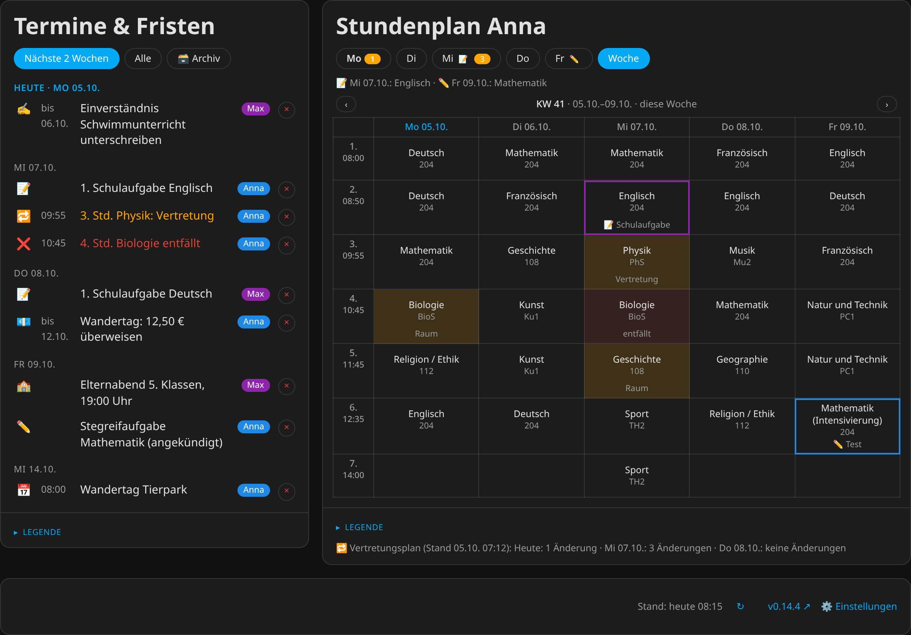
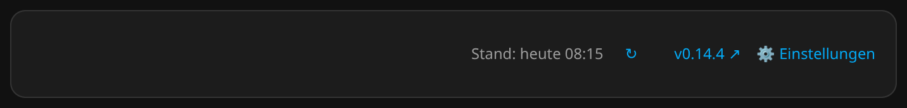
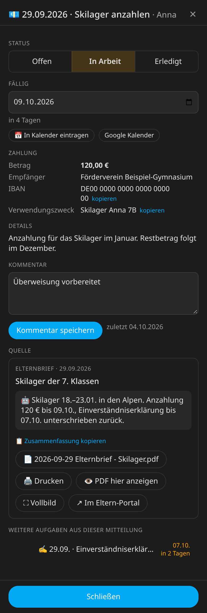
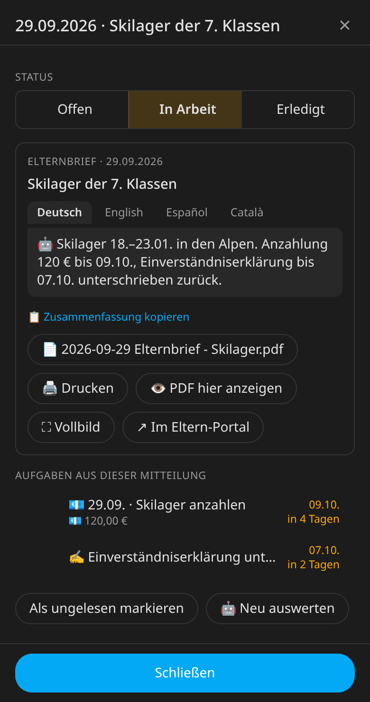
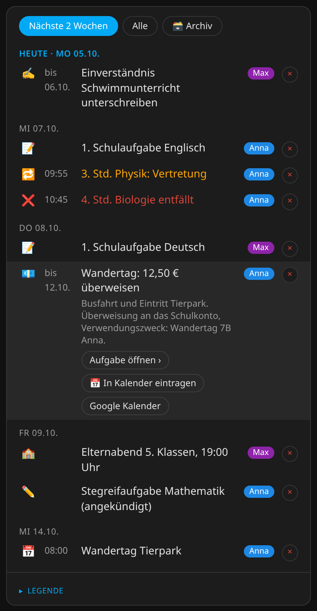
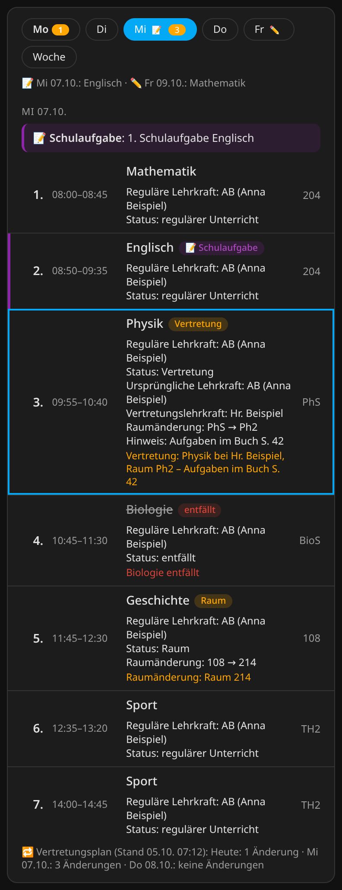
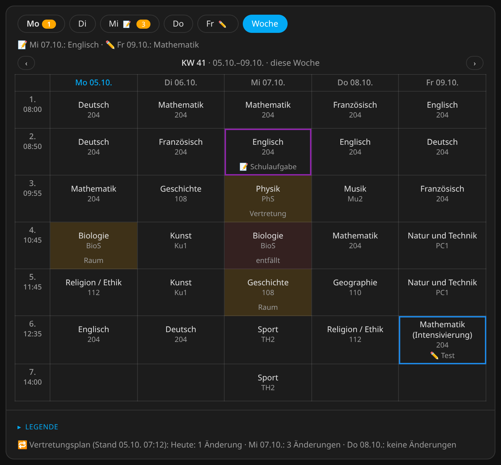

# Eltern Portal Manager Bavaria for Home Assistant

[](https://github.com/hacs/default/pull/12349)
[](https://github.com/FabusMingAI/ha-schulmanager/actions/workflows/validate.yml)
[](https://github.com/FabusMingAI/ha-schulmanager/actions/workflows/tests.yml)
[](LICENSE)

**Deutsch:** [README.de.md](README.de.md)

**Eltern Portal Manager Bavaria** (formerly *Schulmanager*) turns the flood of school messages from **[Eltern-Portal](https://www.eltern-portal.org)** (used by many schools in Bavaria and other German states) into tasks, deadlines and reminders in Home Assistant – for all your children and schools in one place.

It signs in to the portal itself, stores parent letters and attachments per child, lets an AI read out what you actually have to do (sign, pay, return, bring along …) and reminds you in time.



> **Release status:** The latest release is [v0.14.5](https://github.com/FabusMingAI/ha-schulmanager/releases/tag/v0.14.5). Screenshots show its cards with fictional data, including the compact footer, red archive × and selectable lesson details.

> [!NOTE]
> Eltern Portal Manager Bavaria is a private hobby project and is not affiliated with the provider of Eltern-Portal. It reads the portal's web pages because there is no official API, so changes to the portal can break single features at any time. Use at your own risk, without warranty. Bug reports and ideas are welcome as [issues](https://github.com/FabusMingAI/ha-schulmanager/issues) – answers come when time allows.

> [!IMPORTANT]
> **Formerly "Schulmanager".** Up to version 0.13 this integration was called *Schulmanager* and used the domain `schulmanager`. The same domain is used by **[Schulmanager Online](https://github.com/MrIcemanLE/Schulmanager-homeassistant)** – a different integration for schools that use *schulmanager-online.de* – so the two could not be installed side by side. Since 0.14 this integration is **Eltern Portal Manager Bavaria** (domain `eltern_portal_schulmanager`) and both work together, e.g. one child at an Eltern-Portal school and the other at a Schulmanager Online school. Updating from 0.13 or older? See [Renamed from Schulmanager](#renamed-from-schulmanager) – the bridge release 0.14.1 can take over your existing setup automatically.


[Quality work (Bronze → Gold), diagnostics, troubleshooting and removal](docs/QUALITY_SCALE.md)

## Features

- **Reads the portal directly** – parent letters (*Elternbriefe*), messages from teachers, notice board, surveys, **exams and tests** (*Schulaufgaben, Stegreifaufgaben* …), **timetable**, **substitution plan** (*Vertretungsplan*) and **sick notes** (*Krankmeldungen*). Several schools and children with one installation.
- **Files per child** – PDFs and attachments go to `Media › eltern_portal_schulmanager › <child> › <school year>`.
- **AI analysis** via Home Assistant's [AI Task](https://www.home-assistant.io/integrations/ai_task/) (Anthropic, OpenAI, Google, Ollama …): summary, urgency, tasks, deadlines, amounts, IBAN and payment reference, appointments. Without AI a simple rule-based detection is used.
- **Portal tasks** – open surveys become "Umfrage beantworten" and unconfirmed letters become "Empfang im Portal bestätigen"; those tasks complete when the portal reports them as done.
- **Tasks with status** *open / in progress / done*, comments, due dates – as a to-do list, calendar and sensors.
- **Reminders** by push notification (with *Done* and *Remind me tomorrow* buttons), a daily morning summary and optional voice announcements.
- **Exams and tests in the timetable** – exams (*Schulaufgaben*) and tests (*Tests, Kurzarbeiten, Stegreifaufgaben*) from the portal's appointments are highlighted in the timetable and appear in the calendar; the morning summary mentions tomorrow's exams. Other school appointments (holidays, office hours …) are hidden by default and can be switched on in the settings. Portal appointments that come with a time (e.g. "14:00 - 16:00") get that time in the calendar, all others are all-day entries.
- **Timetable & substitutions** – cancelled lessons, substitute teachers and room changes appear in the timetable card, the calendar (with lesson times) and the morning summary; a new change triggers a push notification.
- **Configurable defaults:** fetch every 30 minutes; task reminders at 18:30, 3 days before, the day before and on the due date (overdue tasks daily); morning summary at 06:45 when something is due or pending.
- **Traffic light per child** – red / yellow / green for dashboards and automations.
- **Four dashboard cards included**, set up automatically in the "Schule" dashboard – see [The cards](#the-cards).

> Cards and notification controls use German text. AI summaries can be shown in German, English, Spanish and Catalan; configuration dialogs are available in English and German.

## The cards

The integration loads four cards automatically and places them in the "Schule" dashboard; no separate frontend installation is needed. Since 0.14.3, the card and icon are served from the integration’s own static paths, and the dashboard resource is registered automatically. The three content cards accept an optional `child: <name>`; without it they show all children. The footer displays the integration-wide fetch status.

### Footer – `custom:eltern-portal-schulmanager-header`

<p align="left"></p>

A compact footer at the end of every generated dashboard view shows the live fetch time, refresh button, installed version with release link and settings link. The existing card type remains valid. Option: `settings_path`.

### Tasks & messages – `custom:eltern-portal-schulmanager-card`

Shows the tabs **Aufgaben** (tasks), **Mitteilungen** (messages) and **Erledigt** (done) per child.

<p align="left"> </p>

- Every task shows the **date its message appeared in Eltern-Portal** in front of the title (`29.09. · Skilager anzahlen`; own tasks: the day you added them) – also in the dialogs (with year), the morning summary and the to-do lists.
- While AI summaries are being translated (e.g. after adding a language), a progress line "🌐 Zusammenfassungen werden übersetzt …: 34 von 90" appears at the top of the card.
- **Tap the status icon** of a task to change it right in the list: the circle (open) or ⏳ (in progress) marks it **done**, the green check reopens it. Done tasks are no longer struck through – the check and the **Erledigt** tab already say so.
- **Tap a task's text** to open its details: status **open / in progress / done**, change the due date, add your own **comment**, payment details with "copy" for IBAN and payment reference, plus the **source** with AI summary, original text, PDF and a link to Eltern-Portal.
- **Tap a message** to see its text, the PDF and the tasks created from it; it is marked as read. Messages also have the status **open / in progress / done**: done messages move to the **Erledigt** tab (and count as read), messages in progress show ⏳.
- Below the **Mitteilungen** tab: **Alle als gelesen markieren** (mark all as read) and **Alle als erledigt markieren** (mark all as done, after a confirmation – they move to **Erledigt**).
- Deadlines in the task dialog have **📅 In Kalender eintragen** and **Google Kalender** (see below).
- The **AI summary** has one tab per language chosen in the settings (German, English, Spanish, Catalan).
- **Copy text:** everything in the dialogs can be selected; "📋 … kopieren" copies the AI summary or the message/PDF text, "kopieren" next to IBAN and payment reference copies just that value.
- **PDFs:** "Drucken" opens the browser's print dialog, "Vollbild" shows the PDF full screen (on phones without full-screen support it opens in a new tab).
- "In progress" still counts as open: the task stays in the traffic light and reminders and shows up in the to-do list with ⏳.

### Appointments & deadlines – `custom:eltern-portal-schulmanager-termine`

<p align="left"></p>

- All appointments, deadlines and substitution plan changes, grouped by day, overdue items on top. Switch between **next 2 weeks**, **all** and **🗃️ Archiv**.
- **Archive entries you no longer need:** hover an entry (on phones the button is always shown) and click the **red ×** ("Ins Archiv verschieben"). It disappears from the list and moves to **🗃️ Archiv** (right of **Alle**, with the number of archived entries). There, **↩️** brings it back. Works on the overview and on every child's tab; the archive is stored in Home Assistant, so it is the same on all devices. Archiving only hides the entry in the card – deadlines stay open tasks and keep their reminders, the calendar is unchanged. Entries that no longer exist are removed from the archive automatically.
- **Tap or click an entry** to expand it and again to collapse it – the same for every kind of entry. Expanded, it shows the AI's short summary, location and source, **Aufgabe öffnen › / Mitteilung öffnen ›** for deadlines and appointments from a letter, and **📅 In Kalender eintragen**. With a mouse, hovering shows the short summary as a tooltip.
- **📅 In Kalender eintragen** puts exactly this one entry into your own calendar – you decide which ones. It opens an `.ics` file: iPhone/iPad (Safari) offers "Add to Calendar", Outlook and most calendar apps open it as an event to save. **Google Kalender** opens the event in Google Calendar (handy on Android, where `.ics` files are not always imported). The `.ics` file uses a stable `UID`; whether importing it again updates an existing event depends on your calendar app. The Google link opens a prefilled event form; saving it repeatedly can create duplicates. The `.ics` file includes a reminder at 6 pm the day before for all-day entries, or one hour before for timed entries. Only the `.ics` links are signed and valid for 24 hours. In the Home Assistant Companion app the link opens in the browser.
- A **collapsible legend** at the bottom explains the icons: 📝 exam (*Schulaufgabe*), ✏️ test / short test / pop quiz, 🏫 school appointment, 📅 appointment from a message, ❌ lesson cancelled, 🔁 substitution, 🚪 room change, 🤒 sick note, and deadlines by type (💶 payment, ✍️ signature, ↩️ reply, 🎒 bring along, 📖 read, ✅ task). With several children each one gets its own colour.

### Timetable & substitutions – `custom:eltern-portal-schulmanager-stundenplan`

<p align="left"></p>

<p align="left"></p>

<p align="left"><sub>Screenshots show made-up demo data (`docs/screenshots/demo.html`, [regeneration instructions](docs/screenshots/README.md)).</sub></p>

- Day view with times and rooms, switchable to the whole **week**. In the morning it shows today; after the last lesson and at weekends it shows the next school day. With `view: week` the card starts in the week view; the "Schule" dashboard uses this for all timetables.
- **Week navigation:** use ‹ / › to go back or forward one week and **Heute** to return to the starting week. The heading shows the calendar week and Monday–Friday dates; at weekends the starting week is the following week. The week-view legend can be expanded or collapsed.
- The week view fits narrow cards (e.g. half a column or a phone) without horizontal scrolling: subjects are shortened there ("Mathe", "Engl.", "Reli/Eth", "SA" for exam).
- Subjects are **written out** ("Biologie" instead of "B", "Mathematik (Intensivierung)" instead of "MInt", "Sport" instead of "Sm/Sw"); hover a subject to see the original abbreviation.
- Changes from the substitution plan are highlighted: red = cancelled, orange = substitution or room change. The number on a weekday shows how many changes are coming up.
- Click or tap a lesson in the timetable week view to open its date and focus that lesson. The day view shows available regular and substitute teachers, rooms, status and notes; use **Woche** to return.
- Tap an exam/test box or a substitution in the day view for **📅 In Kalender eintragen** / **Google Kalender**.
- **Exams and tests** are marked: 📝 / ✏️ on the weekday buttons, a box above the lessons of that day and a badge on the matching subject (purple = exam, blue = test). Upcoming ones for the next two weeks are listed above the timetable.

## Requirements

- Home Assistant **2025.8** or newer (custom brand icon from 2026.3)
- An Eltern-Portal parent account (`https://<school>.eltern-portal.org`)
- Optional: an AI Task entity for the analysis

## Installation

### HACS / Marketplace (recommended)

1. On **Home Assistant 2026.11 or newer**, open **Settings → Marketplace**. On **2026.10 or older**, open **HACS**. Search for **Eltern Portal Manager Bavaria**.
2. Install the integration and restart Home Assistant.

The integration is included in the default catalog; adding a custom repository is no longer necessary. In HACS, check the country filter if the integration does not appear: this repository is listed for **Germany (DE)**.

Starting with Home Assistant 2026.11, Marketplace replaces HACS and takes over existing installations automatically. Do not install HACS separately on those versions. See the [official Marketplace announcement](https://www.home-assistant.io/blog/2026/11/04/release-202611/#welcome-to-the-marketplace).

[](https://my.home-assistant.io/redirect/hacs_repository/?owner=FabusMingAI&repository=ha-schulmanager&category=integration)

### Manual

Download the source archive of the [latest release](https://github.com/FabusMingAI/ha-schulmanager/releases/latest), extract it, copy `custom_components/eltern_portal_schulmanager` to `/config/custom_components/eltern_portal_schulmanager` and restart Home Assistant.

## Releases and updates

As of **5 November 2026**, the latest release is **[v0.14.5](https://github.com/FabusMingAI/ha-schulmanager/releases/tag/v0.14.5)**. It adds the compact dashboard footer, red archive ×, selectable lesson details and integration category, recovers notice-board text and attachments, and includes refreshed documentation and screenshots.

Install updates through HACS or Marketplace and restart Home Assistant. The version displayed in the "Schule" status bar is the running integration’s version; the downloaded version only becomes active after a restart.

**Notice-board recovery:** Version 0.14.5 includes the fix for missing notice-board text and attachments ([#33](https://github.com/FabusMingAI/ha-schulmanager/pull/33)). Previously empty notices are supplemented and analysed again on the next regular fetch, keeping their read/completion state and without an additional notification. See the [changelog](CHANGELOG.md#0145--2026-11-05) for this release.

## Renamed from Schulmanager

Existing installations are taken over completely: credentials, settings, tasks, messages with status and comments, the archive, AI summaries, stored files, entity IDs and their history.

**The bridge release 0.14.1 handles this automatically.** It is a one-off release: it arrives once more under the old name *Schulmanager*, installs *Eltern Portal Manager Bavaria* and takes over your setup by itself. A notification confirms it – then **restart Home Assistant once more**. That's all.

**Still on 0.13 or older?** Newer releases (0.14.2 and later) no longer contain the bridge, so install 0.14.1 first: in HACS, use *Eltern Portal Manager Bavaria* → ⋮ → **Redownload** → version **v0.14.1** → *Download*. In Marketplace (Home Assistant 2026.11+), open the repository page → ⋮ → **Install another version** and select **v0.14.1**. Then restart Home Assistant (twice, as above). Afterwards install the latest update as usual. (If Home Assistant still shows version 0.13 in the header of the "Schule" dashboard after updating to 0.14.2 or later, this is the reason.)

> **Using [Schulmanager Online](https://github.com/MrIcemanLE/Schulmanager-homeassistant) as well?** It uses the same folder `custom_components/schulmanager`. If you already took over by hand with 0.14.0 *and* installed Schulmanager Online afterwards, skip 0.14.1 and update straight to 0.14.2 or later – those install into `custom_components/eltern_portal_schulmanager` again and never touch Schulmanager Online's folder.

If the automatic takeover fails, *Settings → Repairs* shows **"Schulmanager could not be moved to Eltern Portal Manager Bavaria"**. Restart once; if the notice stays, take over by hand:

1. **Settings → Devices & services → Add integration → Eltern Portal Manager Bavaria** (or open [this link](https://my.home-assistant.io/redirect/config_flow_start/?domain=eltern_portal_schulmanager)). It finds the old setup and offers **Take over** – no need to enter passwords again.
2. **Restart Home Assistant** once more. A notification confirms the takeover.

[](https://my.home-assistant.io/redirect/config_flow_start/?domain=eltern_portal_schulmanager)

What changes:

| Up to 0.13 | From 0.14 |
|---|---|
| Integration *Schulmanager*, domain `schulmanager` | *Eltern Portal Manager Bavaria*, domain `eltern_portal_schulmanager` |
| Actions `schulmanager.refresh`, `schulmanager.mark_read`, … | `eltern_portal_schulmanager.refresh`, `eltern_portal_schulmanager.mark_read`, … |
| Events `schulmanager_new_item`, `schulmanager_task_reminder`, `schulmanager_substitution` | `eltern_portal_schulmanager_new_item` (with `child`, `item_uid`, `title`, `summary`, `urgency`, `tasks`), `eltern_portal_schulmanager_task_reminder`, `eltern_portal_schulmanager_substitution` |
| Cards `custom:schulmanager-card`, `-termine`, `-stundenplan`, `-header` | `custom:eltern-portal-schulmanager-card`, `-termine`, `-stundenplan`, `-header` |
| Files in `Media › schulmanager › …` | `Media › eltern_portal_schulmanager › …` |

Done automatically during the takeover:

- **Dashboards** – the "Schule" dashboard and your own dashboards are switched to the new card types; buttons calling `schulmanager.*` actions are changed too.
- **Entity IDs stay the same** (`sensor.schule_<child>_…`, `todo.schule_<child>_aufgaben`, `calendar.schule_<child>_kalender`, `sensor.schulmanager_letzter_abruf`), so history, areas and existing cards keep working.
- **Stored files** are moved to the new media folder.
- **Buttons in push notifications** sent before the update (*Gelesen*, *Erledigt*, *Morgen erinnern*) keep working.
- The old dashboard resource, `/config/www/schulmanager` and the old folder `custom_components/schulmanager` are removed – the folder only if it belongs to this project, never the one of Schulmanager Online.

### Repair notice for automations and scripts

Automations and scripts are never changed automatically. If any of them still call a `schulmanager.…` action or listen to a `schulmanager_…` event, Home Assistant shows **"Automations still use the old Schulmanager names"** under **Settings → Repairs**, listing each automation and script by name. Change them to the new names from the table above – the notice disappears by itself once no old name is left (checked at every start and whenever automations or scripts are reloaded). If Schulmanager Online is installed as well, `schulmanager.refresh` could belong to it and is therefore not reported.

Not carried over: PDF and calendar links in push notifications sent before the update no longer open – open the message in the dashboard instead.

## Setup

1. **Settings → Devices & services → Add integration → Eltern Portal Manager Bavaria**
2. Enter the school code (the part before `.eltern-portal.org`) – or simply paste the link from a portal notification e-mail – plus e-mail and password. Add more schools in the same dialog.
3. **Configure → Settings** – grouped into collapsible sections (*KI & Sprachen*, *Benachrichtigungen & Erinnerungen*, *Termine & Klassen* open; *Sprachansagen*, *Abruf & Ablage*, *Dashboard* collapsed), every field with a short explanation: choose the AI Task entity, the phones for push notifications (`notify.mobile_app_…`), reminder days and times, optionally speakers or Assist satellites for announcements, **which portal appointments to show** (default: exams and tests; optionally also school appointments), **only appointments of the child's class** (default on: hides entries such as "Schullandheim 5b+5c" or "Jgst. 10" that name only other classes or grades), **how teachers are shown** in timetable and substitution plan (default *abbreviation and name*, e.g. "Mü (Maria Müller)"; or *name only*, or *abbreviation only*) and the **languages of the AI summary** (checkboxes for German, English, Spanish, Catalan, up to 4; default German and English; the first selected language in the fixed order German → English → Spanish → Catalan is used for push summaries). If an already analysed message lacks a language – also after you add one – the AI translates just the summary in the background; tasks, appointments and status stay untouched. With 5 or more translations you get a Home Assistant notification when they start (with an estimated duration) and when they are done; a failed translation is retried after 6 hours, up to 3 attempts.
4. **Dashboard**: the integration creates the **"Schule"** dashboard in the sidebar by itself – tabs **Overview** (appointments & deadlines of all children on the left, each child's timetable with substitutions on the right, with a compact footer in every view for the last fetch, version and a "⚙️ Einstellungen" link) plus **one tab per child** (tasks & messages, timetable with substitutions, appointments), ideal on phones. Under **Configure → Settings → "Schule" dashboard** you can switch to *Single page* or *Do not manage*. Dashboards you change by hand are left alone (regenerate with the action `eltern_portal_schulmanager.rebuild_dashboard`). The YAML in [`dashboard/`](dashboard/eltern_portal_schulmanager_dashboard.yaml) is only an example for your own dashboards.

On the first run the last 120 days are imported; recent messages from the last 21 days, unconfirmed letters and surveys whose closing date has not passed are analysed and marked unread, older items are stored as read without automatic analysis. A single setup notification replaces individual notifications for the initial import.

## Entities (per child)

| Entity | Description |
|---|---|
| `sensor.schule_<child>_status` | Traffic light `rot` / `gelb` / `gruen`; attributes contain open tasks and recent messages |
| `todo.schule_<child>_aufgaben` | Task list – complete, reschedule, add your own tasks |
| `calendar.schule_<child>_kalender` | Deadlines, appointments from letters, exams and tests (school appointments if enabled; with their time if the portal gives one), substitutions, cancelled lessons and sick notes |
| `sensor.schule_<child>_offene_zahlungen` | Open payments in € |
| `sensor.schule_<child>_nachste_frist`, `…_uberfallig`, `…_offene_aufgaben`, `…_ungelesene_mitteilungen` | Counters and next deadline |
| `sensor.schule_<child>_stundenplan` | Timetable: lessons today; day and week plan as attributes |
| `sensor.schule_<child>_vertretungen` | Substitution plan: changes from today (cancelled lessons, substitutes, room changes); new entries are pushed and shown in calendar and morning summary. Each entry also carries `lehrkraft_name` and `vertretung_name` when the teacher abbreviation is known |
| `sensor.schule_<child>_krankmeldungen` | Sick notes: school days off sick in the current school year; list of sick notes (from, to, days, comment) and the latest one as attributes |
| `sensor.eltern_portal_manager_bavaria_letzter_abruf` (taken over from 0.13: `sensor.schulmanager_letzter_abruf`) | Diagnostics: last update, errors, pending analyses (`auswertung_ausstehend`) and pending translations (`uebersetzung_ausstehend`) |

Entity IDs follow your Home Assistant language (shown here for German).

## Actions

| Action | Purpose |
|---|---|
| `eltern_portal_schulmanager.refresh` | Fetch all portals now |
| `eltern_portal_schulmanager.mark_read` | `item_id` or `child`, without either: all messages; optional `read: false` marks them unread |
| `eltern_portal_schulmanager.complete_task` | `task_id`, optional `done` (default `true`); complete or reopen a task |
| `eltern_portal_schulmanager.update_task` | `task_id` and `status`, `comment`, `due`, `title` or `details` |
| `eltern_portal_schulmanager.update_item` | `status` (`offen`, `in_arbeit`, `erledigt`) of a message (`item_id`); without `item_id` for all messages of `child` (or of all children), returns `changed` |
| `eltern_portal_schulmanager.add_task` | `child`, `title`; optional `due`, `amount`, `details`, `type` |
| `eltern_portal_schulmanager.reanalyze` | `item_id`; analyse a message again using the configured AI service or rules |
| `eltern_portal_schulmanager.archive_event` / `eltern_portal_schulmanager.unarchive_event` | `child` and `event_id` (uid of an entry in "Termine & Fristen"): move it to the archive or bring it back |
| `eltern_portal_schulmanager.send_digest` / `eltern_portal_schulmanager.send_reminders` | Send summary or reminders now |
| `eltern_portal_schulmanager.rebuild_dashboard` | Regenerate the "Schule" dashboard |
| `eltern_portal_schulmanager.get_overview` | Returns everything as a response – e.g. for an Assist script "What's up at school?" |

Events for your own automations: `eltern_portal_schulmanager_new_item` (with `child`, `item_uid`, `title`, `summary`, `urgency`, `tasks`), `eltern_portal_schulmanager_task_reminder` and `eltern_portal_schulmanager_substitution` (new substitution plan entries, with `child` and `entries`).

## Good to know

- **Receipt confirmation:** Eltern-Portal counts downloading a parent letter as *receipt confirmed*. With automatic file storage enabled, the integration therefore confirms new letters when it fetches the PDF. Turn off "Store attachments/PDFs automatically" if you do not want that – you then get a task "confirm receipt in the portal" instead.
- **Privacy:** school data and downloaded files are stored locally in Home Assistant. If you select an AI service, the text and PDF content of a message is sent to that provider for analysis. File links in the dashboard are signed and expire after 30 days; calendar (`.ics`) links after 24 hours. An `.ics` file contains the entry as shown in the card (teacher names as set in *Termine & Klassen*) and is passed to your browser/calendar app when opened. Opening **Google Kalender** sends the event’s title, times, description and location to Google.
- **Substitution plan layouts:** depending on the school, Eltern-Portal shows the substitution plan with 6 columns (with *Fach*, a replaced subject struck through) or with 5 columns without a subject. Both are read; without a subject column the subject is taken from the timetable when it is unambiguous.
- **Timetable, substitution plan and sick notes** are only available if the school has enabled them in Eltern-Portal. If such a page is missing or the portal drops the connection there, only that section is skipped (noted in `sensor.eltern_portal_manager_bavaria_letzter_abruf`); everything else is still fetched. If the portal briefly returns an empty page, the last known data is kept.
- **Unofficial:** Eltern-Portal has no public API. Access uses the library [pyelternportal](https://github.com/michull/pyelternportal), which reads the web pages. If the portal layout changes, single sections may stop working until an update; the error shows up in `sensor.eltern_portal_manager_bavaria_letzter_abruf`.
- **Teacher names:** Eltern-Portal lists the timetable abbreviations of all teachers under *Service → Schulinformationen* ("Stundenplankürzel der Lehrkräfte"). The integration reads this list per school once a day and shows the names next to the abbreviations in the timetable, substitution plan, calendar, hover texts and push notifications – as set in *Termine & Klassen*. Each school has its own list; unknown abbreviations stay as they are. The separately fetched abbreviation-to-name list is not sent to the AI service. Sender names and names within message text can still be included in the analysis.
- **Changed messages:** if a teacher edits a message in the portal, it is analysed again and shown as unread. Pure formatting differences (spaces, line breaks) are ignored, and if most known messages look different at once (e.g. after a portal or integration update), they are updated quietly instead of all becoming unread again.
- **Connection:** every fetch uses its own fresh connection per school. If the portal drops it ("Server disconnected"), the integration tries once more after a few seconds before keeping the last known data.
- **Sick notes** are only read, never submitted – report sickness in the portal as usual.
- **Not yet included:** communication with the class teacher (only subject teachers) and the class register.
- If you also use the HACS integration `elternportal`, keep both on the same `pyelternportal` version (here 0.0.27).
- This project is not affiliated with Eltern-Portal or its operator.

## Development

The test workflow uses **Python 3.13**. From the repository root:

```bash
python3.13 -m venv .venv
source .venv/bin/activate
python -m pip install -r requirements_test.txt
python -m pytest
```

Before publishing a release, keep the version in the integration manifest, the card and the bridge manifest aligned, update [CHANGELOG.md](CHANGELOG.md), and ensure Tests, HACS and hassfest pass. The manual **Release** workflow publishes from `main` and runs the tests again.

Issues and pull requests are welcome.

## License

[MIT](LICENSE)
